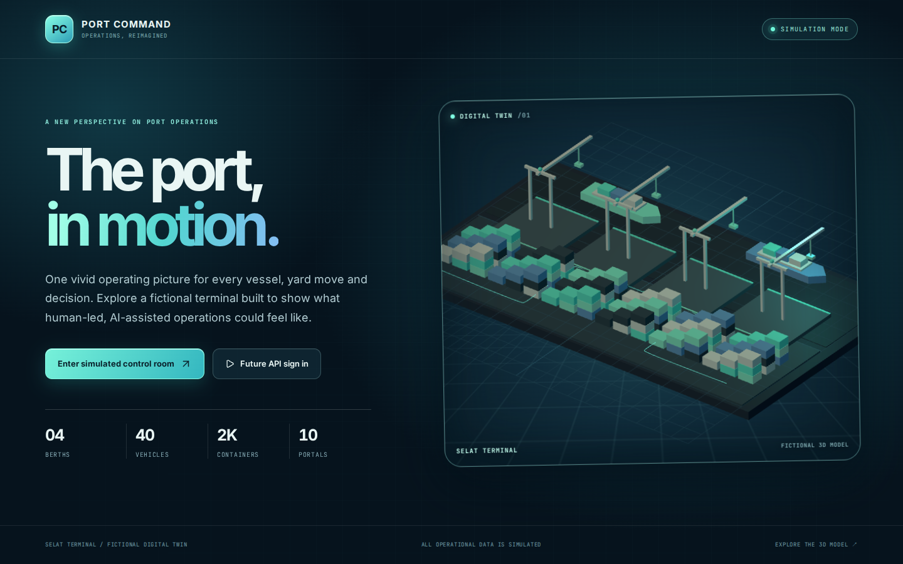
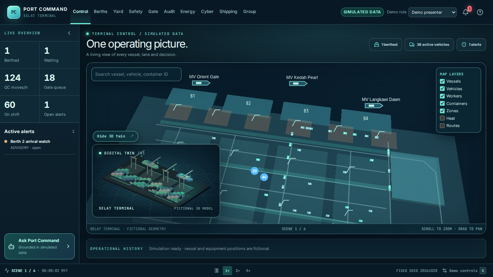

# Port Command

Port Command is an offline capable concept demo of an AI assisted port operations decision layer. **Selat Terminal is fictional. Every operational value in this build is simulated.** The five named MMC sea ports on the group page are illustrative comparison tiles, not connected deployments.





[View the 3D container yards](docs/map-3d-preview.png) · [close-up of stacked containers and a prime mover](docs/map-3d-vehicle-preview.png).

[Larger map overview](docs/map-larger-overview.png) · [closer container yard](docs/map-larger-yard.png).

[Compact-window map with readable stacks and a truck](docs/map-compact-large.png).

[Loaded truck and linked container](docs/truck-with-container.png) · [empty truck](docs/empty-truck.png) · [moving worker GPS](docs/worker-gps.png).

[View the light control room](docs/light-mode-preview.png) · [light landing page](docs/light-landing-preview.png).

[View the refreshed group dashboard](docs/group-preview.png).

[Watch the five-minute browser backup](docs/port-command-stage-backup.webm) (314.68 seconds, WebM).

## Start on macOS or Linux

Docker Engine/Desktop and Docker Compose are the only runtime prerequisites on the host. All language packages are installed in containers. From this project root:

```bash
cp -n .env.example .env
docker compose config --quiet
docker compose up --build -d
docker compose ps
docker compose logs --tail=100 -f frontend nginx
```

Open [http://localhost:8088](http://localhost:8088), then choose **Enter simulated control room**. The only host port is Nginx on `127.0.0.1:8088`. `frontend`, `backend`, PostgreSQL, Redis, Celery worker and Celery beat are private to the `port-command` Compose network. The Compose project name and volumes are isolated from other projects.

The frontend source is mounted for hot reload; `node_modules` and `.next` live in Docker volumes. After changing `package-lock.json`, run `docker compose exec -T frontend npm ci` to update that volume. The production stage build requires `PORT_COMMAND_ALLOW_PRODUCTION_SIMULATION=true` explicitly for a simulated stage deployment; the development server runs simulation by default.

## Verify inside containers

```bash
docker compose exec -T frontend npm run lint
docker compose exec -T frontend npm run typecheck
docker compose exec -T frontend npm run test -- --run
docker compose --profile test run --build --rm --no-deps frontend_build
docker compose --profile test run --build --rm frontend_e2e
docker compose exec -T backend python manage.py check
docker compose exec -T backend python manage.py showmigrations
docker compose ps
```

The frontend production build uses an isolated profile service, so it does not alter the running development `.next` volume. The E2E profile uses a Playwright browser image in this same Compose project.

## Demo controls

| Key | Action |
|---|---|
| `/` | Open/close the scripted copilot |
| `Esc` | Close an overlay or inspector |
| `D` | Show stage controls |
| `Shift+1` to `Shift+6` | Jump to a repeatable stage scene |
| `1` to `4` | Control, Berths, Yard, Safety |

Use **Run Stage Demo · 5 minutes** for automatic scene changes with one continuous audit trail, or **Reset full simulation** before manual scene jumps. Scene 4 triggers a rule-driven Crane 3 hold and incident. Scene 5 offers a human-approved two-prime-mover recovery proposal. The copilot is deterministic and has twelve suggested intents; it does not call a language model.

The landing page and control room include a locally rendered animated 3D terminal model. Move the pointer across it to shift the viewpoint; **Hide 3D twin** restores the full map view. The model pauses when offscreen, runs at a lower frame rate in the inset, and respects reduced-motion settings. The tilted MapLibre view uses local geometry and a local worker. Its four labeled yards show stored 20-foot and 40-foot containers in five-tier 3D stacks; containers in transit appear on their assigned vehicles. Vehicle routes use perimeter and inter-yard lanes so their modeled footprints avoid the stacks. The 40 vehicles have distinct prime mover, truck, AGV and reach stacker forms. Loaded vehicles carry a linked 40-foot container with its ID, vessel and origin slot in the vehicle inspector; empty vehicles show only their vehicle record. Compact windows open at a closer road-and-yard view so both a truck and the container stacks are readable. Use **View container yard** for a still closer look or search an ID to inspect it, then choose **Overview** to return to the full port. The 60 fictional workers move along marked walkways with simulated GPS fixes. Standard demo roles see zone-level positions; the demo supervisor sees moving individual pins and precise fictional coordinates.

The single **Light/Dark** switch in each page header changes the complete interface, including the map palette. The choice is saved locally and restored before the page renders. Where supported, switching uses a brief view transition; reduced-motion settings skip it.

## Offline stage run

Build and start the stack while online. Then disconnect the laptop from the internet and use `http://localhost:8088/control`. The map geometry, map worker, fonts, icons, fixtures and scripted copilot are local. A browser with WebGL and module workers is required for MapLibre rendering. If unavailable, the app presents a fallback message while other portal data remains usable. Test the exact presenting laptop at 1920×1080 and 1366×768 before stage use. The map caption includes a canvas FPS readout for the device rehearsal. A browser-recorded five-minute backup can be generated with the Docker-only command in the [stage demo checklist](docs/stage-demo-checklist.md).

## Runtime modes and data boundary

`NEXT_PUBLIC_PORT_COMMAND_MODE=simulation` is the default. All ten portal views read the local seeded simulation; the frontend does not need Django at runtime in this mode. `NEXT_PUBLIC_PORT_COMMAND_MODE=api` refuses to show simulation values as live operations. The BFF routes and typed data source contract are prepared for future Django endpoints, but the backend currently exposes **only** `/healthz/`. It does not issue JWTs or implement port records, approvals or operational APIs.

Never use demo roles or client-side redaction as production authorization. A future Django implementation must enforce role, organization, terminal and object scope, worker privacy, approvals and audit writes server-side. See [backend integration contract](docs/backend-integration-contract.md).

## Lifecycle

```bash
docker compose logs --tail=100 frontend backend nginx celery_worker celery_beat
docker compose restart frontend
docker compose down
docker compose up -d
```

`docker compose down` preserves this project's named PostgreSQL and Redis volumes. **Only** an intentional `docker compose down -v` deletes those volumes. To refresh pinned base images and rebuild within this project:

```bash
docker compose build --pull
docker compose up -d
```

Do not run global Docker prune operations. See [Docker operations](docs/docker-operations.md) for service health and troubleshooting.

## Project structure

- `frontend/`: Next.js App Router, ten portal routes, map, copilot, simulation engine, tests and future BFF contracts.
- `backend/`: health-only Django/DRF project with PostgreSQL and Redis/Celery wiring.
- `deploy/nginx/`: single local reverse proxy.
- `doc/`: original user-provided source documents, preserved as received.
- `docs/`: implementation matrix, integration contract, decisions, operations, versions and current status.
